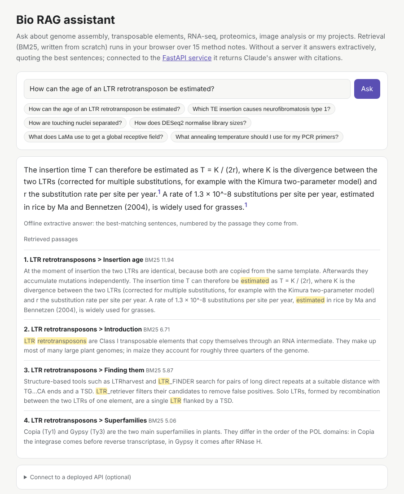

# bio-rag-assistant

[](https://github.com/liuweisu/bio-rag-assistant/actions/workflows/ci.yml)
**[Try the search and offline answers in your browser](https://liuweisu.github.io/bio-rag-assistant/)**

> **About this repository.** This is a showcase of work I did during my studies at Wageningen University & Research (WUR). The original research and course code lives on WUR's internal GitLab and is not public. The code here was rebuilt quickly with help from Claude, an AI assistant, to show the methods and results; it is not the original thesis or course code.

A retrieval-augmented generation (RAG) assistant that answers bioinformatics questions from a set of method notes and cites the exact passage behind each statement. When the notes do not contain the answer, it says so.

It covers the parts of an AI engineering job that are not the model itself: retrieval, grounding, evaluation, an API, a container, tests and CI.



## Design

```
question ──> BM25 retrieval (top 4 chunks) ──> answerer ──> answer + citations
                    │                              │
             15 markdown notes,             Claude: each chunk is a document block
             split by section               with citations enabled
                                            offline: best-matching sentences, or abstain
```

| Part | File | Notes |
| --- | --- | --- |
| Chunking | [`corpus.py`](src/biorag/corpus.py) | One chunk per `##` section, long sections split at paragraphs; the document title stays in every chunk |
| Retrieval | [`retrieval.py`](src/biorag/retrieval.py) | BM25 written from scratch; optional dense retrieval (sentence-transformers) and reciprocal rank fusion |
| Answers | [`generate.py`](src/biorag/generate.py) | Claude with the API's built-in citations, or an extractive baseline that needs no model |
| Evaluation | [`evaluate.py`](src/biorag/evaluate.py), [`eval/questions.jsonl`](eval/questions.jsonl) | 34 answerable questions labelled with the right note and expected facts, plus 6 that the notes cannot answer |
| Service | [`api.py`](src/biorag/api.py), [`Dockerfile`](Dockerfile) | FastAPI with `/ask`, `/search`, `/health`; input validation; upstream errors become HTTP 503; CORS so a website can call it |

Choices worth explaining:

- **BM25 before embeddings.** Questions in this field are full of exact terms (L1HS, N50, DnaA, hAT) that lexical search matches well. On this corpus BM25 already puts the right note first for 33 of 34 questions, so a vector database would add cost and no measurable gain. The dense and hybrid retrievers are there for larger, more varied collections.
- **Citations from the API, not from the prompt.** Each retrieved chunk is sent as a separate `document` block with citations enabled, so every cited sentence points to a character range in a specific chunk. Asking the model to "cite sources" in free text is much easier to get wrong.
- **Abstention is part of the contract.** The system prompt tells the model to reply with a fixed marker when the documents do not contain the answer, and the evaluation counts how often it does so on unanswerable questions.
- **An offline baseline.** The extractive answerer runs without any API key (tests, CI and the browser demo use it) and shows how much an LLM adds on top of retrieval.

## Results

Run with `biorag eval`:

| | Value |
| --- | --- |
| Retrieval recall@1 / recall@4 / MRR | 0.97 / 1.00 / 0.99 |
| Extractive baseline: answer contains an expected fact | 0.76 |
| Extractive baseline: cites the right note | 0.88 |
| Extractive baseline: abstains on unanswerable questions | 5 of 6 |
| Extractive baseline: wrongly abstains on answerable questions | 0.12 |

The extractive baseline shows the usual trade-off: a stricter coverage threshold (0.75 instead of 0.6) abstains on all six unanswerable questions but also refuses 38% of answerable ones. The threshold was chosen on this same small question set, so treat these numbers as a sanity check rather than a held-out score.

To evaluate the Claude answerer (this calls the API and costs a few cents):

```bash
export ANTHROPIC_API_KEY=...
biorag eval --mode claude --save results.json
```

I have not included Claude numbers in this README yet; run the command above and add them. The Claude code path is covered by unit tests that use the SDK's own response types with a fake client.

## Run it

```bash
git clone https://github.com/liuweisu/bio-rag-assistant
cd bio-rag-assistant
pip install -e ".[dev]"

biorag search "target site duplication"           # retrieval only
biorag ask "How is the age of an LTR element estimated?" --mode extractive
biorag ask "How is the age of an LTR element estimated?"   # uses Claude if ANTHROPIC_API_KEY is set
biorag eval
pytest
```

As a service:

```bash
docker build -t bio-rag-assistant .
docker run -p 8000:8000 -e ANTHROPIC_API_KEY bio-rag-assistant
curl -X POST localhost:8000/ask -H 'content-type: application/json' -d '{"question": "What is N50?"}'
```

The model is set with `BIORAG_MODEL` (default `claude-opus-5-5`). Requests use low effort, because short grounded answers do not need long reasoning, and opt in to the API's server-side fallback in case a safety classifier declines a request.

## Use your own documents

Put markdown files in `corpus/` (one `#` title, `##` sections), add questions for them to `eval/questions.jsonl`, and run `biorag eval` before and after every change to chunking, retrieval or prompt.

## Related

[rnaseq-agent](https://github.com/liuweisu/rnaseq-agent) is the agent side of the same question: there the model calls analysis tools on a local open-weight model instead of reading documents.

## License

MIT
